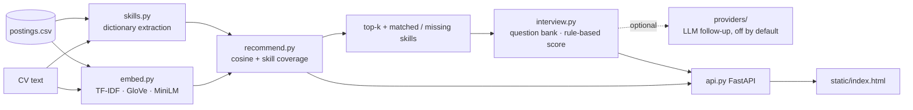

# job-recommender-chatbot

This repo shows a small, inspectable job recommender: paste CV text, get the top-k postings
with the skills that matched and the skills that are missing, then rehearse a mock interview
for the posting you pick. Everything runs offline with no API key; an LLM backend can be
switched on behind an interface but is off by default.

**The postings are synthetic.** The build sandbox could not reach Kaggle or the Hugging Face
Hub, so `data/postings.csv` (500 rows) is produced by `scripts/generate_postings.py` from
twelve role-family templates with a fixed seed. Company names are fictional. The loader
accepts any CSV with `id,title,company,location,description` columns, so a real dataset
can be dropped in locally (see TODO.md).

## Data path



Score per posting: `(1 − α) · cosine(CV, posting) + α · coverage`, where coverage is the share
of the posting's required skills found in the CV by the dictionary extractor. α = 0.5 by
default; the evaluation below compares α ∈ {0, 0.5, 1}.

## Run it

```bash
pip install -r requirements.txt
make check                      # ruff + 34 pytest tests + data reproducibility + quick eval
make serve                      # http://localhost:8000  (API docs at /docs)
make vectors && make eval       # optional: GloVe backend (66 MB download) + full evaluation
docker build -t jobrec . && docker run -p 8000:8000 jobrec   # not run in the sandbox (no daemon)
```

Example API call:

```bash
curl -s localhost:8000/recommend -H 'content-type: application/json' \
  -d '{"cv_text":"ESP32 firmware in C with FreeRTOS, MQTT over TLS, Python with pandas","k":3}'
```

returns, per hit, `score`, `similarity`, `skill_coverage`, `matched_skills`, `missing_skills`,
`bonus_skills` (nice-to-haves the CV has) and a one-line `explanation`. `POST /interview/start`
with a `posting_id` and the CV text opens a session; `POST /interview/answer` scores each answer
and returns the next question, then a summary after the last one.

## What the outputs look like

For a CV mentioning ESP32, C, FreeRTOS, MQTT, Flutter, Firebase, pandas and scikit-learn the
top hits (TF-IDF, α = 0.5) are IoT-engineer and ML-engineer postings, e.g.
`IoT Solutions Engineer — matches c, esp32, mqtt, python; missing linux, tls`. The interview for
that posting asks eight questions: an intro, one per required skill (skill-specific question
where the bank has one, e.g. MQTT QoS/retained/last-will, otherwise a category template), one
"gap" question about a missing skill, and one behavioural question. Each answer gets a 0–100
score (60 % expected-keyword coverage, 25 % length up to 60 words, 15 % for a concrete example),
the keywords it missed, and a follow-up.

## Evaluation (numbers from `make eval`, in `figures/eval_results.json`)

`data/eval/queries.csv` holds 50 CV texts written by hand for this repo, 4–5 per role family,
some phrased with aliases or without exact skill names. A posting counts as relevant when its
role family equals the family the CV was written for (`scripts/build_eval_labels.py`; on
average 41.7 relevant postings per query, chance P@k = 0.083).

| embedder | α | P@1 | P@5 | P@10 | MRR |
|---|---|---|---|---|---|
| tfidf | 0.0 | 1.00 | 0.99 | 0.98 | 1.00 |
| tfidf | 0.5 | 0.98 | 0.98 | 0.97 | 0.98 |
| tfidf | 1.0 | 0.94 | 0.94 | 0.91 | 0.96 |
| glove | 0.0 | 0.60 | 0.57 | 0.53 | 0.68 |
| glove | 0.5 | 0.96 | 0.96 | 0.93 | 0.97 |
| glove | 1.0 | 0.94 | 0.94 | 0.91 | 0.96 |

What the data supports:

- **The benchmark is easy, and that is a property of the synthetic data, not of the model.**
  Postings are built from the same skill vocabulary the CVs use, so word-level TF-IDF is near
  the ceiling. Do not read 0.98 as a real-world number.
- **Skill coverage alone (α = 1) is worse than text similarity** because many postings tie on
  coverage; the text breaks the ties. α = 0.5 loses little and buys the explanation.
- **Averaged GloVe vectors alone are poor (P@5 0.57).** Mean pooling blurs specific terms, and
  two short mobile-developer postings become "hubs" that appear for CVs of almost every family.
  Adding skill coverage fixes most of it (0.96), which is the case for keeping the explicit skill
  signal even with a semantic embedder.
- The one TF-IDF miss at α = 0.5 is a data-platform CV (Kubernetes, Prometheus, CI/CD) ranked
  against cloud/DevOps postings; by the family rule that is wrong, by a human reading it is
  arguable. The label rule is the weak point of this evaluation (see Limitations).

The MiniLM sentence-embedding backend (`requirements-minilm.txt`) is implemented but **has no
numbers here**: the model could not be downloaded in the sandbox. TODO.md item 1.

## Limitations

- Synthetic postings (see above); fictional companies; English only.
- Skill extraction is a dictionary of 91 skills with aliases, matched as whole phrases. It has
  no context: "C" matches the letter in "section C", "Go" is only recognised as "golang", and a
  skill spelt differently from every alias is missed. Its coverage bounds the explanations.
- Relevance labels come from a rule (same role family), not from human judgement per pair; a
  good cross-family recommendation counts as a miss.
- Interview scoring is keyword and length based. It rewards mentioning the right terms, not
  being right. It is a rehearsal aid, not an assessment.
- Interview sessions live in process memory (capped at 200); restarting the server drops them.
- Docker image not built in the sandbox (no daemon); MiniLM backend not exercised.

## Next steps

See TODO.md: real postings dataset through the same loader, MiniLM numbers, a hand-judged
subset of labels, a results figure, more skill-specific interview questions.

## Related

This recommender is a from-scratch rebuild of a student-project idea; the skill vocabulary
is weighted towards embedded/IoT/ML roles because that is the author's field. The MQTT, ESP32
and FreeRTOS interview questions are the ones an IoT firmware interview would actually ask.

## Licence

MIT, see LICENSE. GloVe vectors (if downloaded) are public domain (PDDL), from the gensim-data
release.
